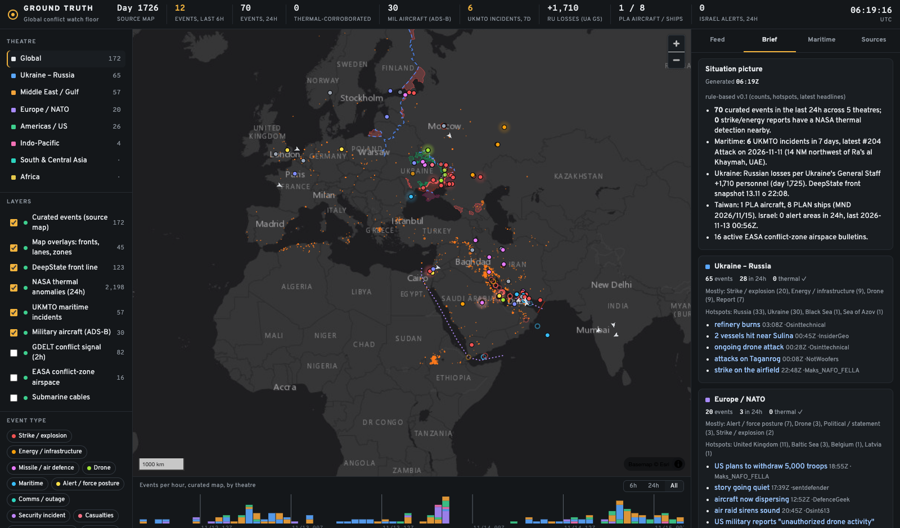
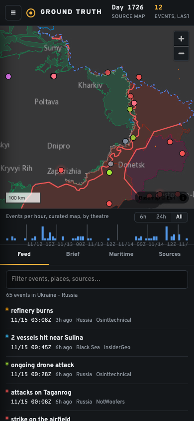

# Ground Truth

An OSINT conflict watch floor. It turns the *Global War News Map* (a daily-updated public Google My Maps) into a timestamped, classified, archived feed, then fuses it with live open sources: front lines, fire satellites, maritime incidents, military aircraft, ship traffic, internet outages and travel advisories, plus volunteer geolocations, natural hazards and earthquakes, a news wire, public Telegram channels, tsunami, radiation and sanctions signals, emergency squawks, flight restrictions, GPS jamming, and cyber and internet-routing signals. Coverage is global: Ukraine–Russia, Europe/NATO, Middle East/Gulf, Indo-Pacific, South and Central Asia, Africa and the Americas.

The server pushes each refreshed feed to open pages as it lands. An optional analyst agent (Claude, headless, no tools) writes a note on every new event and a whole-picture assessment every few hours.





## Run

```bash
cp config/mymaps.example.json config/mymaps.local.json   # then put the map ID in it
python3 server.py                                         # http://127.0.0.1:8790
GT_HOST=0.0.0.0 GT_PORT=8790 python3 server.py            # LAN / container
python3 -m gt.mymaps                                      # one-off ingest + archive
```

It needs only the Python 3.9+ standard library. State is written to `data/` (or `$GT_DATA`).

On macOS, privacy controls (TCC) can stop `/usr/bin/python3` from reading `~/Desktop`; use a Homebrew Python or keep the checkout elsewhere.

## Configuration

| Setting | Where |
|---|---|
| Source map ID | `config/mymaps.local.json` (git-ignored; see `config/mymaps.example.json`) or `$GT_MYMAPS_MID` |
| Source-map auto-follow (optional) | The curator's channel ID as `"channel"` on the map entry in `config/mymaps.local.json`, `$GT_MYMAPS_CHANNEL` or `$GT_SEED/mymaps.channel`. With none, Ground Truth polls the configured map only. `$GT_MAP_OVERLAP_H` (default 48) sets how long the previous map's pins are kept after a switch |
| Extension modules | `ENABLED` in `gt/extfeeds.py` (all eight since 0.13.0). `$GT_EXT_FEEDS` (a comma list, or `all`) overrides it for local tests |
| Firecrawl key (UKMTO, CENTCOM releases) | `$FIRECRAWL_API_KEY` or `~/.config/firecrawl/key` |
| AISStream key (ships) | `$AISSTREAM_API_KEY`, `$GT_SEED/aisstream.key` or `~/.config/aisstream/key` (`tools/aisstream-key.sh` saves it hidden) |
| Global Fishing Watch token (ship traffic) | `$GFW_API_TOKEN`, `$GT_SEED/gfw.key` or `~/.config/globalfishingwatch/key` (`tools/gfw-key.sh` saves it hidden) |
| Analyst write key | `$GT_SEED/analyst.token` or `$GT_DATA/analyst.token` on the server (with none, every analyst write is refused), `~/.config/ground-truth/analyst_token` for the runner |
| Analyst model access | the Claude Code CLI's own login, or a `claude setup-token` token in `~/.config/ground-truth/claude_token` |

Every other feed is keyless. `/api/status` shows the health of each feed.

Firecrawl use is capped per source per day (`FIRECRAWL_DAILY` in `gt/feeds.py`), so the free tier's 1,000 credits a month are enough. Run only one polling instance per key.

## Layout

| Path | What |
|---|---|
| `server.py` | One-port HTTP server, background scheduler, push stream, analysis (corroboration, brief, summary) |
| `gt/mymaps.py` | KML fetch, parse, classify, timestamp, archive (`data/snapshots`, `data/groundtruth.sqlite`) |
| `gt/mapfollow.py` | Source-map auto-follow (0.10.0). The curator starts a new My Maps file about weekly and links it from their channel. Each map refresh reads the channel's public RSS feed, switches when the newest linked map's "Day N" is at least the current one, and keeps reading the previous map for 48 h so the feed does not empty. A hand change of the configured map always wins. Map and channel IDs stay out of every API reply |
| `gt/feeds.py` | Live feeds and refresh intervals (`REGISTRY`) |
| `gt/extfeeds.py` | Extension-module loader (0.11.0). Each module exposes `FEEDS` (name, function, interval) and its sources' terms in `LICENCE`, `ATTRIBUTION`, `PUBLIC_OK` and `NON_COMMERCIAL`. `ENABLED` lists the modules a release runs; their feeds join `REGISTRY`. A module that fails to load is reported in `/api/status` `modules` and never stops the server |
| `gt/geoconfirmed.py` | GeoConfirmed volunteer geolocations worldwide: the global CSV export, 14 days, hourly, keyless |
| `gt/curated.py` | CIR Eyes on Russia (verified civilian harm, published about a week late on purpose) and S2 Underground's Iran kinetic events: keyless ArcGIS layers, every 3 h |
| `gt/hazards.py` | GDACS disaster alerts (15 min) and EMSC + USGS earthquakes M4+ (5 min). USGS explosion types and shallow quakes in watched areas are flagged as a tripwire |
| `gt/wire.py` | News wire: 44 publisher RSS feeds and 30 Google News searches, each on its own cadence with ETag/Last-Modified. 1.5.0 adds strikes and drones on Russia and Iran, interceptions, ballistic missile launches, air-raid sirens and drone launches worldwide, and Iranian and Middle East outlets; state and partisan outlets say so in their label. Google News ignores `when:1d` in a query longer than about 200 characters, so every query is kept to 195 or less (a test checks it). At most 5 searches per 5-min call, 4 s apart. 48 h of stories; the same story from several outlets is merged, and each is placed by `placer.py` |
| `gt/telegram.py` | Fourteen public Telegram channels from their web previews, every 5 min, 48 h of posts |
| `gt/translate.py` | English translations of non-English wire and Telegram items (1.5.0): stores what the analyst posts (7 days, checked field by field), and `/api/feed/wire` and `/api/feed/telegram` serve the English text with the original kept in `title_orig` / `summary_orig` and a `translated: {from, by}` mark |
| `gt/placer.py` | Places a headline or post on countries and a theatre from its text (names, demonyms, capitals, leaders), with guards for people's names |
| `gt/signals.py` | Tsunami and volcano bulletins (PTWC, NTWC, JMA), Germany's BfS gamma network (each station against its own baseline), OFAC recent actions, DHS NTAS advisories |
| `gt/airspace.py` | Emergency squawks 7500/7600/7700 worldwide (adsb.lol every 60 s, adsb.fi only as a fallback), FAA temporary flight restrictions with shapes (15 min), GPSJAM's daily GNSS-interference hexes (drawn since 1.1.0) |
| `gt/cyber.py` | CISA KEV, ICS and general advisories, Ransomware.live claims and press-reported attacks, SANS ISC infocon, DDoSia target lists (victim names, domains and target IPs are never stored), and RIPEstat routing visibility for 19 watched countries against a 7-day baseline |
| `gt/ais.py` | AISStream ship sampler: a stdlib websocket client with permessage-deflate, 60 s sample every 5 min, ships kept 3 h, a 30-day registry of static data (type, IMO, size, destination, draught), tanker tracks, and a back-off after HTTP 429. In practice AISStream accepts one connection at a time. Since 1.5.0 each sample listens worldwide: ships in the watch boxes are kept as before, and military ships (AIS type 35, or a navy name or prefix on a non-civilian type) wherever they are heard, which uses about 5x the data |
| `gt/gfw.py` | Global Fishing Watch ship traffic: daily non-fishing ship counts for 4 chokepoints and 6 seas over a year, the same week last year, ship lists at chokepoints, AIS-off events. Every 6 h, about 4 days behind |
| `gt/mid.py` | Flag state from an MMSI (ITU Maritime Identification Digits table) |
| `gt/portwatch.py` | IMF PortWatch daily chokepoint transits: 28 chokepoints, tankers and all ships per day, 7-day average against the same week a year ago, 30-day sparkline. Every 6 h, about 3 days behind |
| `gt/sanctions.py` | OpenSanctions maritime list, daily: sanctioned (S), Ukraine GUR shadow-fleet list (G) and port-state detention (D) marks, matched by IMO, then MMSI |
| `gt/alerts.py`, `gt/embassy.py` | Air-raid and siren alerts (Tzeva Adom, alerts.in.ua) and US embassy alert RSS, served together at `/api/alerts` |
| `gt/aircraft.py` | Military aircraft identity: registry type and operator from hexdb.io (cached per airframe), and a role (tanker, ISR, fighter, transport, helicopter, ...) for the map icons |
| `gt/geo.py` | Offline country, sea and theatre lookup (Natural Earth 1:50m in `ref/`), with each country's label point |
| `gt/analysis.py` | Analyst results store (`$GT_DATA/analysis/`): per-event notes and whole-picture history |
| `web/` | Watch floor client (MapLibre GL). Every URL is relative, so it works behind a path prefix such as `/gt/`. See "The page" below |
| `web/ext/` | Page extensions, one per module group: `curated.js`, `hazards.js`, `wire.js`, `signals.js`, `airspace.js`, `cyber.js`. Each queues its setup through `window.GTXQ` and uses the `window.GTX` API (layers, popups, tabs, Feed streams, KPIs, Brief columns). `index.html` loads one only when its modules are enabled |
| `web/vendor/` | MapLibre GL 5.6.0 (BSD-3-Clause) and, since 1.1.0, h3-js 4.5.0 (Apache-2.0) to turn GPSJAM's H3 cell ids into hexagons. Each ships with its licence file |
| `web/geo/theatres.json` | Country to theatre, label point and names, so Feed items that only name a country follow the theatre filter. Built by `tools/build_theatres.py` from `gt/geo.py`, the server's own rule |
| `analyst/analyst.py` | The analyst runner: `cycle`, `events`, `picture`, `status`, `translate`, `--dry-run`. `translate` (1.5) sends up to 40 untranslated non-English wire and Telegram items to Claude Haiku and posts the English back; run it every 5 minutes, under its own lock. Calls `claude -p` with no tools, no MCP and an empty working directory, and posts results to the server. From 1.4 the whole-picture prompt also gets the module sources from `/api/digest`, as untrusted text. Run `cycle` every 30 minutes from cron or launchd. Point it at your server with `base_url` in `analyst/config.json` or `$GT_BASE_URL` |
| `analyst/claude-token.sh` | Saves a long-lived Claude token for the runner, hidden |
| `deploy/image/` | Runtime container: Python plus a supervisor that runs the bind-mounted app and restarts it when `VERSION` changes |
| `tests/` | Offline tests (no network): run each `tests/test_*.py` with `python3 -I`, for example `python3 -I tests/test_090.py`. `test_120_feed.py` and `test_130_tz.py` also need `node` |
| `tools/local_test.py` | Runs the app on a throwaway copy of `data/` with Firecrawl off, on port 8791. Set `GT_PROD_STATUS` to your production instance's `/api/status` URL to make its AIS samples wait for that instance's gap |
| `tools/live_proxy.py` | Serves this checkout's `web/` on 127.0.0.1:8793 against another instance's API (`$GT_UPSTREAM`), GET only, so a page change can be tried on real data with no feeds run locally |
| `tools/feed_check.js` | Headless Chromium (Playwright) check of the Feed tab against a running page: order, chips, links, Show more, theatre filter, the time-zone switch, console errors |
| `tools/build_theatres.py` | Rebuilds `web/geo/theatres.json`; `--check` exits 1 when it is out of date |

## The page

- **Map and rail.** One layer per source, all on at load. The rail picks the theatre and the time range (6h, 24h, All), and the activity timeline can be brushed to a window.
- **Feed.** Every timestamped source in one list, newest first: map pins, official statements, maritime warnings, alerts, internet outages, airspace, hazards, cyber, the news wire and Telegram. A chip per source group shows its count and hides or shows it (saved per browser). Rows with a place have a "View on map" button. The theatre, time range, timeline brush, category chips and search box all apply. It draws 300 rows, then "Show more". Positions and measurements (fire pixels, ships, aircraft, ship-traffic counts, the front line, cables, GPSJAM) stay map layers.
- **Title bar.** Each Feed row opens with a bar: flag, country, date and time with the time since, and the category in its colour. With no country it names the sea, the theatre or "Global", and never guesses. Where the system draws no emoji flags, the ISO code shows in a small box.
- **News ticker.** A broadcast-style ticker under the header shows the newest Feed items, with flag, country, headline and time since. It updates by itself, holds on hover or focus, and scrolls with the wheel. Its own controls: SRC picks which source groups it shows (the theatre, time range, categories and search follow the Feed), a pause button, and a speed button (0.5x to 3x). All three are saved per browser. Clicking an item shows it on the map, or opens its source when it has no place.
- **Times.** Eastern time (EST/EDT) by default, with the time since. The header clock or Times in the rail switches to UTC, and the choice is saved per browser. Date-only items stay on their own day in either zone.
- **Tabs.** Feed, Wire, Alerts, Brief (with "All sources by theatre"), Maritime, Analyst, Signals, Cyber and Sources (each feed's age, interval and stale flag, and every credit).
- **Live light.** The header shows the page's version and its state: Live (the push stream is connected), Polling (no stream, but replies are coming in), Offline, or Public copy. Its tooltip gives the reason, the page and server versions, and how many feeds are OK.
- **Push.** The page listens on `/api/stream` and reloads a feed as soon as the server refreshes it. Without the stream it polls: aircraft every 45 s, the rest every 5 min.
- **Tooltips.** With a mouse, every titled element gets a styled tooltip: what each KPI tile counts, each layer's source and freshness, and every tab, theatre and category.
- **Sidebars (PC).** Drag either sidebar's inner edge to resize it (double-click resets it), or use its tab to collapse it and give the map the room. Widths and collapsed state are saved per browser.
- **Phones.** Two columns in landscape. In portrait, a map/list split, with the timeline hidden on small screens. A two-row header with a swipeable stats strip, larger tap targets, a rail drawer with a backdrop, Escape and a close button, tabs and source chips that scroll sideways, a 16 px search box (so iOS does not zoom), safe-area insets, and popups that fit the screen above the map controls.

## API

| Endpoint | Returns |
|---|---|
| `/api/events` | Curated map events and overlays, with `thermal` and `ukmto` corroboration |
| `/api/summary` | Compact KPIs, built for dashboard REST sensors. No module data enters it |
| `/api/brief` | Rule-based per-theatre brief |
| `/api/status` | Health of every feed: last run, error, interval (`every`) and `stale`; plus `modules` (enabled modules, load errors, each feed's `public_ok` and `non_commercial` flags) and the number of open `streams` |
| `/api/stream` | Server-Sent Events: `hello` with the version, then a `feed` event after every feed run. At most 24 streams, each closed after 30 min (the browser reconnects) |
| `/api/feed/<name>` | One feed: mymaps, mil, front, losses, firms, ukmto, gdelt, tzeva, tzevalive, airalerts, embassy, pla, czib, official, outages, advisories, ships, gfw, portwatch, vessellists, cables; from modules: geoconfirmed, cir, kinetic, hazards, quakes, wire, telegram, tsunami, radiation, ofac, ntas, squawk, gpsjam, tfr, cyber, bgp |
| `/api/alerts` | Live air-raid, siren and US embassy alerts (ETag; 304 when unchanged) |
| `/api/outages_geo`, `/api/advisories_geo`, `/api/czib_geo` | Country shapes for the internet-outage, travel-advisory (Level 3–4) and EASA conflict-zone map layers |
| `/api/news_geo` | One point per country with wire and Telegram counts for 24 h and 48 h. Non-commercial |
| `/api/cyber_geo` | Country shapes with ransomware, critical-infrastructure, attack and DDoS counts and the routing level. Non-commercial |
| `/api/digest` | Compact view of the module sources for the analyst: verified pins by theatre, hazards, quakes, signals, wire and Telegram headlines, cyber. Non-commercial |
| `/api/xpost?id=` | Text and media of one X post, fetched on demand and cached |
| `/api/analysis` | Analyst overview: latest picture, events analysed, recent runs |
| `/api/analysis/events` | Per-event analyst notes, keyed by event id |
| `/api/analysis/history?limit=&full=1` | Past whole-picture assessments, newest first |
| `POST /api/analysis/events`, `/api/analysis/picture`, `/api/translations` | Analyst writes. Need the `X-GT-Token` header |

The API keeps every time in UTC; only the page converts.

## What the public live copy carries

The GitHub Pages copy is a static snapshot of a running instance, not a live server. It is refreshed every 10 minutes, and pushed early when the alerts change, but never two pushes closer than 7 minutes apart.

- **Carried:** the core feeds, plus the extension feeds whose module marks them `PUBLIC_OK`: `kinetic`, `hazards`, `quakes`, `radiation`, `tsunami`, `ofac`, `ntas`, `squawk` and `tfr`. `squawk` is carried without its adsb.fi fallback sightings (personal use only).
- **Left out:** `geoconfirmed`, `cir`, `wire`, `telegram`, `gpsjam`, `cyber` and `bgp`, whose terms do not allow republishing or have not been cleared, and the endpoints built from them. Also the live push stream (`/api/stream`) and the post-text lookup (`/api/xpost`).
- Its `/api/status` lists only the feeds the copy carries.
- On a `github.io` host the page knows it is the public copy: it does not try the push stream, hides the "Load post text" button, and the live light reads "Public copy". Its alerts can be up to about 10 minutes old, so it never shows a live siren.

## Data terms

- **Global Fishing Watch data is CC BY-NC 4.0, non-commercial only.** The page shows "Powered by Global Fishing Watch" linked to globalfishingwatch.org wherever the data appears, and the token stays server-side. `server.NON_COMMERCIAL_KEYS` lists the summary keys to strip before any commercial use, and analyst pictures written with prompt `pic3` or later contain GFW-derived reasoning.
- **IMF PortWatch chokepoint data** is credited "Sources: UN Global Platform; IMF PortWatch (portwatch.imf.org)" wherever it appears, with the numbers unaltered. Ground Truth treats it as non-commercial.
- **OpenSanctions maritime data is CC BY-NC 4.0, non-commercial only**, credited wherever it appears. A mark is a list match by IMO number or, failing that, MMSI. An MMSI can be reused by another ship, so MMSI matches are labelled as such. `server.NON_COMMERCIAL_KEYS` also lists the PortWatch and OpenSanctions summary keys.
- Flag states come from the ITU's Maritime Identification Digits table.
- **Aircraft photos come from Planespotters.net** under its photo API terms: the browser asks the API directly, the image loads straight from their CDN with its URL unchanged, the photographer is credited next to it, and the thumbnail is a plain link to the photo page. Never store, proxy or re-host the images, and never use them or their metadata to build ML datasets.
- **Aircraft types and operators come from hexdb.io** (free, keyless), looked up once per airframe and cached.
- **Alerts:** Israel's come from Tzeva Adom, which relays Home Front Command alerts; Ukraine's, Russia's and Poland's from alerts.in.ua's public situation report. Both are free and keyless, and the page credits and links both. US embassy alerts are State Department messages from each post's own feed (US government works, public domain).
- Country shapes are Natural Earth (public domain). The bundled MapLibre GL JS keeps its own BSD licence header.
- **Module sources (0.11.0+).** Each module states its sources' terms in `LICENCE`, `ATTRIBUTION`, `PUBLIC_OK` and `NON_COMMERCIAL`, and `/api/status` `modules` carries each feed's flags. The page credits every source (the Sources tab lists them all). No module data enters `/api/summary`. `/api/digest`, `/api/cyber_geo` and `/api/news_geo` are built from module feeds and are non-commercial as a whole, and so are analyst pictures from runner 1.4 on, which read `/api/digest`.

| Source | Feed | Licence or terms | Non-commercial | Public copy |
|---|---|---|---|---|
| GeoConfirmed volunteer geolocations | `geoconfirmed` | No formal licence; GeoConfirmed's API says the data is freely available for research, journalism and analytical use | Yes | No |
| CIR Eyes on Russia | `cir` | No licence stated; CIR offers open access to the results of its analysis | Yes | No |
| S2 Underground Iran kinetic events | `kinetic` | CC BY-NC-SA 4.0 (S2 Underground © 2025 by S2A1): credit and licence link, share-alike; Ground Truth's changes are marked | Yes | Yes |
| GDACS disaster alerts | `hazards` | Reuse with acknowledgement (European Commission legal notice); automatic, "as is", not a substitute for national alerts | No | Yes |
| EMSC earthquakes | `quakes` | CC BY 4.0, credit EMSC-CSEM SeismicPortal | No | Yes |
| USGS earthquakes | `quakes` | US government, public domain | No | Yes |
| News wire: publisher RSS feeds and Google News searches | `wire` | Headlines and links only, each the property of its publisher; BBC feeds are for personal non-commercial use; Google News results under Google's terms | Yes | No |
| Public Telegram channels (web previews) | `telegram` | Each post is the channel's own content: short text with a link back | Yes | No |
| NOAA PTWC and NTWC tsunami bulletins | `tsunami` | US government, public domain | No | Yes |
| JMA tsunami and volcano bulletins | `tsunami` | JMA Public Data License 1.0 (CC BY 4.0 compatible): source credited, edits marked | No | Yes |
| BfS gamma dose-rate network (Germany) | `radiation` | Datenlizenz Deutschland Namensnennung 2.0 (dl-de/by-2-0), attribution required | No | Yes |
| OFAC recent actions | `ofac` | US government work, public domain | No | Yes |
| DHS NTAS advisories | `ntas` | US government work, public domain | No | Yes |
| adsb.lol emergency squawks | `squawk` | ODbL 1.0: attribution, share-alike for derived databases | The feed is flagged non-commercial, for the adsb.fi fallback | Yes |
| adsb.fi (fallback only) | `squawk` | Personal, non-commercial use only | Yes | No: the public copy drops adsb.fi sightings |
| FAA temporary flight restrictions | `tfr` | US public domain; not for navigation | No | Yes |
| GPSJAM daily GNSS interference | `gpsjam` | No licence stated by gpsjam.org; treated as non-commercial | Yes | No |
| CISA Known Exploited Vulnerabilities | `cyber` | CC0 1.0 | No (the `cyber` feed as a whole is) | No |
| CISA ICS and cybersecurity advisories | `cyber` | US government, public domain | No (the `cyber` feed as a whole is) | No |
| Ransomware.live claims and press-reported attacks | `cyber` | Non-commercial only; named and linked on the page; no raw-data republishing; polled no faster than every 30 min | Yes | No |
| SANS Internet Storm Center infocon | `cyber` | CC BY-NC-SA 4.0 | Yes | No |
| witha.name DDoSia tracker | `cyber` | No licence stated; terms: see the source's site | Treated as yes (the `cyber` feed as a whole is) | No |
| RIPEstat routing data (RIPE NCC RIS) | `bgp` | Network analysis, monitoring and research use; no re-packaging or redistribution; no commercial use without RIPE NCC permission | Yes | No |

## Licence

Ground Truth's own code is released under the [MIT License](LICENSE). Bundled third-party files keep their own terms: MapLibre GL JS in `web/vendor/` is BSD-3-Clause (`web/vendor/maplibre-LICENSE.txt`), h3-js in `web/vendor/` is Apache-2.0 (`web/vendor/h3-js-LICENSE.txt`), and the Natural Earth shapes in `ref/` are public domain (`web/geo/theatres.json` is derived from them). The MIT License covers the code only, not the data it fetches: each feed's data stays under its provider's terms (see Data terms above). The same goes for test fixtures taken from real responses, for example: `tests/fixtures/sanctions/` holds a few OpenSanctions rows (CC BY-NC 4.0), `tests/fixtures/gfw_kerch.json` Global Fishing Watch data (CC BY-NC 4.0), `tests/fixtures/portwatch/` trimmed IMF PortWatch responses, and `tests/fixtures/embassy/` US government alert texts (public domain). The fixtures for the 0.11.0+ modules are mostly synthetic, in the real response shapes; the few real ones are trimmed US government responses (public domain), and each test file's header says which is which.

## Caveats

- The source map is one curator's selection of social-media posts. Treat it as unverified.
- Categories are keyword-assigned.
- Analyst notes are model output from unverified posts. They're labelled with model, prompt version and time, and the page shows them escaped, as text only. Analyst prose is written in UTC; in Eastern mode the page adds the Eastern time beside each "HH:MMZ".
- Thermal hits include gas flares and industrial heat.
- AIS coverage comes from volunteer receivers: dense in Europe, none in the Gulf or Red Sea (those boxes are marked "no live receiver coverage"). Zero ships there means no data. A ship sends its type only every few minutes, so a new ship can show as type unknown until the registry learns it.
- PortWatch transits are IMF estimates from AIS, about 3 days behind.
- GFW counts are about 4 days behind and only include ships transmitting AIS. A fall can mean fewer ships or more ships running dark. Chokepoint boxes also count ships at anchor inside them. AIS-off events come from a GFW prototype model and only count gaps that start at least 50 nm from shore.
- IODA outages are automatic detections. A Google-traffic dip alone is weak evidence.
- Alerts are not a safety tool: follow the Home Front Command app in Israel and Povitryana Tryvoha in Ukraine. The page works out "sirens now" from timestamps on the viewer's clock.
- GeoConfirmed geolocations often land days after the event, and CIR publishes about a week late on purpose.
- Telegram posts are the channels' own claims, and several channels are partisan or a party to the war they cover. The page names the channel on every post.
- Wire and Telegram countries are placed from the text and can be wrong ("a story about X" is not "a story from X"). The keyword classifier calls most wire items "other".
- GDACS alerts and earthquake parameters are automatic and preliminary. GPSJAM shows the newest UTC day it has published, usually yesterday, never live. TFRs are not for navigation.
- Ransomware entries are the groups' leak-site claims, not confirmed breaches. DDoSia lists are what a hacktivist group told its bots to hit, not what went down.
- A routing "drop" is fewer prefixes or networks seen by RIPE RIS than the country's own 7-day baseline: often an outage or a shutdown, sometimes a routing change.
- Scraped sources are kept to titles, dates and short excerpts, never whole pages, and every item links back to the original.
